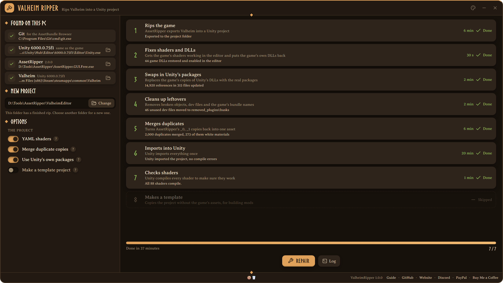

# Valheim Ripper

Rips Valheim into a Unity project. Shaders work in the editor, Unity's packages are installed and it opens without
errors.

## Download

Download **ValheimRipper.zip** from [Releases](https://github.com/CookiexMilk/ValheimRipper/releases).

There's also **ValheimRipper-dotnet.zip**. It's way smaller, but you need the
[.NET Desktop Runtime 8](https://dotnet.microsoft.com/download/dotnet/8.0) installed.

## Requirements

- Windows 10 or 11 (64-bit) with [WebView2](https://developer.microsoft.com/microsoft-edge/webview2/) (Windows 11
  already has it)
- [Valheim](https://store.steampowered.com/app/892970/Valheim/)
- [Unity 6000.0.75f1](https://unity.com/releases/editor/whats-new/6000.0.75f1)
- [AssetRipper](https://github.com/AssetRipper/AssetRipper) 2.x
- [Git](https://git-scm.com/downloads/win) (optional, for the AssetBundle Browser)

## How to use

1. Unzip it into your AssetRipper folder
2. Run it. It should find everything by itself. If something is red, click the folder icon and select it
3. Pick an empty folder for the project
4. Click **Rip it** (takes around 35-40 minutes)
5. Unity opens when it's done

If the shaders break later, select the project and click **Repair**.

## Options

Everything is on by default except the template.

- **YAML shaders**: the game's real shaders. Turn it off and you get dummy shaders instead (materials look wrong,
  particles turn white).
- **Merge duplicate copies**: merges AssetRipper's duplicates (`name_0`, `name_1`) into one.
- **Use Unity's own packages**: replaces the game's Unity DLLs (TextMeshPro, Input System, Timeline etc.) with the
  real packages. UI and TextMeshPro always get replaced.
- **Make a template project**: see below.

## Template project

Also makes a clean project next to the rip called `<name>Template`. Same settings, packages and DLLs, no game assets.
The DLLs are in `Assets/_Template/Assemblies`, and `UILineRenderer` and `Line` in its `Scripts` folder. Use it for your
mods and export what you need from the rip into it.
Untick the game DLLs when exporting, the template already has them.

## For modders

- The game's asset bundle names are cleared in the AssetBundle Browser.
- The graphics APIs are set to Direct3D11 + Vulkan on Windows, Metal on Mac and OpenGLCore + Vulkan on Linux.
- With **Use Unity's own packages** on, the game DLLs have Auto Reference off. Components work like normal. If your
  own scripts use Valheim classes, put them in an assembly definition and reference the DLLs (like
  `assembly_valheim.dll`).
- `Assets/Scripts` has `UILineRenderer` and `Line`. They replace the game's versions so the gamepad map prefabs work.

## Good to know

- The exe isn't signed. If SmartScreen shows up, click **More info** and **Run anyway**.
- Don't put the project in OneDrive, Dropbox etc.
- Excluding the project folder in your antivirus makes the import faster.
- Settings and logs are saved in a `ValheimRipper` folder next to the exe.

## Building

Install the [.NET 8 SDK](https://dotnet.microsoft.com/download/dotnet/8.0) and run `.\release.ps1`. The zips end up
in `release\`.

The Norse font isn't included (its license doesn't allow it). Get it from
[Joël Carrouché](https://www.joelcarrouche.com/fonts/norse) and put `Norse.otf` and `Norsebold.otf` in `UI/fonts`.
Without it the titles use Averia Serif Libre.

Licenses: [THIRD-PARTY-NOTICES.md](THIRD-PARTY-NOTICES.md)

---

🍪🥛

<a href="https://github.com/Valheim-Modding/Wiki/wiki/Valheim-Unity-Project-Guide">Guide</a> ·
<a href="https://github.com/CookiexMilk/ValheimRipper">GitHub</a> ·
<a href="https://valheim.cookiemilk.se/">Website</a> ·
<a href="https://discord.com/invite/7GwrfWuWFn">Discord</a> ·
<a href="https://www.paypal.com/paypalme/CookiexMilk">PayPal</a> ·
<a href="https://buymeacoffee.com/CookiexMilk">Buy Me a Coffee</a>

